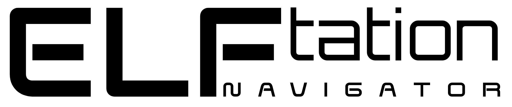

# Curso PS2SDK: Desarrollo Homebrew para PlayStation 2

Curso práctico de programación en C y desarrollo homebrew para PlayStation 2, orientado a construir **ELFtation Navigator (ETN)**, un explorador de archivos propio inspirado en uLaunchELF.

El objetivo es aprender progresivamente los fundamentos del hardware, el lenguaje C, las herramientas de desarrollo y las interfaces de PS2SDK para construir una aplicación funcional.

## Proyecto principal: ELFtation Navigator

  

ETN será un explorador de archivos para PlayStation 2 que permitirá navegar por dispositivos de almacenamiento, visualizar archivos y directorios y, progresivamente, ejecutar archivos ELF compatibles.

El proyecto se desarrollará por etapas, integrando los conocimientos de cada bloque en una aplicación real.

### Objetivos del proyecto

- Construir una aplicación homebrew para PlayStation 2.
- Comprender el funcionamiento del hardware y el ecosistema PS2SDK.
- Aplicar programación modular en C.
- Implementar una interfaz visual y controles mediante DualShock 2.
- Explorar dispositivos de almacenamiento y gestionar archivos.
- Identificar y ejecutar archivos ELF compatibles.
- Integrar los componentes en un explorador funcional.

## Progreso del curso

| Bloque | Contenido | Estado |
|---|---|---|
| 00 | El ecosistema PS2 | CERRADO |
| 01 | Fundamentos de C para ETN | CERRADO |
| 02 | Compilación, Makefile y generación de ELF | CERRADO |
| 03 | Video e interfaz gráfica | EN PROGRESO |
| 04 | Entrada del usuario y DualShock 2 | PENDIENTE |
| 05 | Memoria y almacenamiento | PENDIENTE |
| 06 | Operaciones con el sistema de archivos | PENDIENTE |
| 07 | Detección y ejecución de archivos ELF | PENDIENTE |
| 08 | Integración final del explorador ETN | PENDIENTE |

## Contenido de los bloques

### Bloque 00: El ecosistema PS2

**Objetivo:** comprender el entorno de desarrollo y las características de la consola antes de comenzar la implementación.

Lecciones:

1. Anatomía de una aplicación homebrew.
2. Hardware de PS2 relevante para ETN.
3. Ecosistema homebrew.
4. Nuestro entorno de desarrollo.

### Bloque 01: Fundamentos de C para ETN

**Objetivo:** adquirir los fundamentos del lenguaje C necesarios para organizar y construir los componentes del proyecto.

Lecciones:

1. Funciones y organización del código.
2. Punteros.
3. Estructuras (`struct`).
4. Enumeraciones (`enum`).
5. Memoria y ciclo de vida de los datos.
6. Organización de archivos `.c` y `.h`.

### Bloque 02: Compilación, Makefile y generación de ELF

**Objetivo:** comprender el proceso de compilación para PS2, organizar la construcción del proyecto y generar ejecutables ELF.

Lecciones:

1. Proceso de compilación.
2. Compilar para PlayStation 2.
3. Makefile y automatización de la compilación.
4. Generación de ELF y análisis del ejecutable.

### Bloque 03: Video e interfaz gráfica

**Objetivo:** estudiar el sistema gráfico de PlayStation 2 e implementar los primeros elementos visuales de ETN mediante PS2SDK y GSKit.

Lecciones:

1. Sistema gráfico de PlayStation 2.
2. Inicialización gráfica y dibujo básico.

### Bloque 04: Entrada del usuario y DualShock 2

**Objetivo:** recibir e interpretar las entradas del control para permitir la navegación por la interfaz.

### Bloque 05: Memoria y almacenamiento

**Objetivo:** estudiar los recursos de memoria y los dispositivos de almacenamiento necesarios para el explorador.

### Bloque 06: Operaciones con el sistema de archivos

**Objetivo:** implementar la lectura y navegación de directorios, la identificación de archivos y las operaciones necesarias para explorar dispositivos compatibles.

### Bloque 07: Detección y ejecución de archivos ELF

**Objetivo:** identificar archivos ejecutables y estudiar el proceso de lanzamiento de aplicaciones compatibles desde ETN.

### Bloque 08: Integración final del explorador ETN

**Objetivo:** integrar los componentes desarrollados en los bloques anteriores y consolidar una primera versión funcional del explorador.

## Entorno de desarrollo

El entorno de trabajo contempla:

- Visual Studio Code como editor.
- Docker para trabajar con el entorno de desarrollo de PS2SDK.
- PS2SDK y las herramientas de PS2DEV para compilar aplicaciones.
- Git y GitHub para el control de versiones y la publicación progresiva del curso.
- Una PlayStation 2 Slim para las pruebas del homebrew.
- Una memoria USB con sistema de archivos FAT32 como dispositivo de almacenamiento previsto para las pruebas.

## Metodología de aprendizaje

El curso avanza mediante lecciones progresivas, ejemplos comentados y evaluaciones.

- Cada lección desarrolla conceptos teóricos y prácticos.
- Las evaluaciones permiten comprobar la comprensión de los contenidos.
- Las prácticas se organizan en archivos independientes y reutilizables.
- Al completar un bloque, se actualiza su documentación y estado.
- Los conocimientos se aplican progresivamente al desarrollo de ETN.

## Estado actual

Los bloques 00, 01 y 02 están completados. Se ha estudiado el ecosistema homebrew de PlayStation 2, los fundamentos de C, la organización modular del código mediante archivos `.h` y `.c`, el proceso de compilación, las herramientas de compilación cruzada, la automatización mediante Makefiles y la generación y el análisis de ejecutables ELF.

Actualmente se encuentra en desarrollo el Bloque 03, dedicado al sistema de video y la interfaz gráfica. Ya se estudiaron los fundamentos del sistema gráfico de PS2 y se desarrolló un primer programa mediante GSKit, capaz de dibujar un fondo azul y un rectángulo blanco. El ejecutable fue compilado y probado exitosamente en una PlayStation 2 física.

**Siguiente etapa:** continuar el Bloque 03 y ampliar progresivamente las capacidades gráficas necesarias para construir la interfaz de ELFtation Navigator (ETN).

---

Proyecto educativo y personal en desarrollo.

---

## Copyright

Copyright (C) 2026 Carlos Alberto Mancilla Valle.

## Identidad del proyecto

El nombre ELFtation Navigator (ETN) y su logotipo se
mantienen separados de la licencia que pueda aplicarse
al código fuente y al material educativo de este repositorio.

La publicación de estos elementos no concede por sí sola
permiso para utilizarlos como identidad de otros proyectos
ni para presentarlos como versiones oficiales de ETN.
